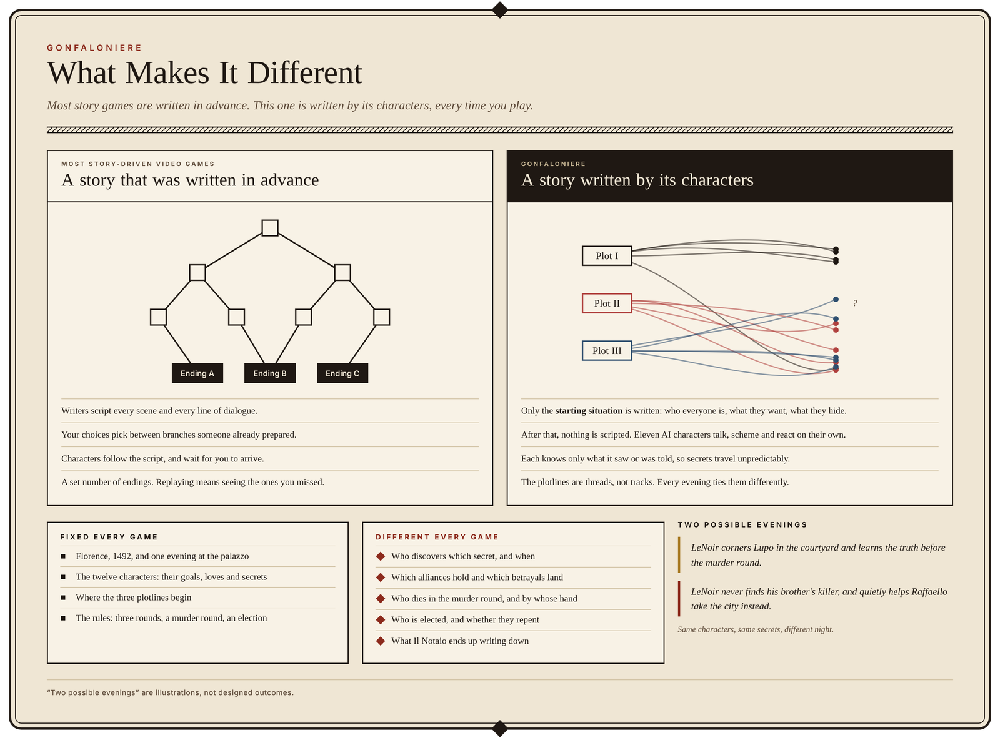
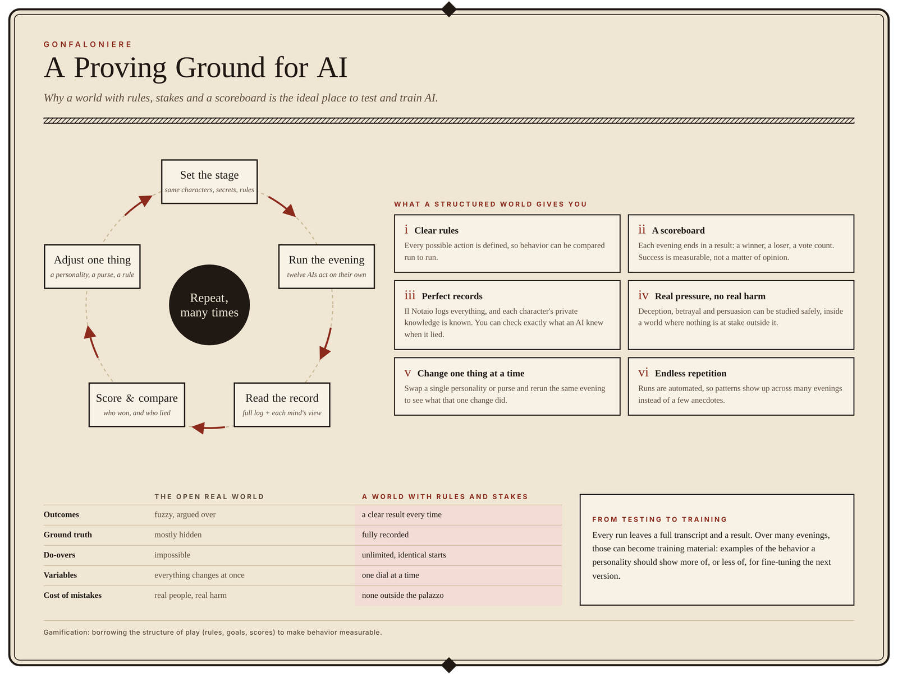

# Gonfaloniere

A political intrigue game played by AI agents.

Florence, 1492. Twelve characters from four factions spend one evening scheming, bribing, and betraying one another over who becomes Gonfaloniere, the city's highest office. Each character is a separate LLM agent that knows only its own briefing and what it has personally seen and heard. Code, not the model, tracks the money, the pensions, and who heard what in front of whom, and no prompt ever holds two characters' private information.

That makes it a testbed too: **how well does a language model hold a secret under pressure** (bluffs, threats, sworn evidence, a loyal master's direct question) while still planning and dealing well?

**▶ [Watch a replay](https://gonfaloniere-replay-1.netlify.app/)** of a six-character mini-game, with each character's private thoughts beside what they say aloud.


## What runs today

- **The mini-game:** six of the twelve characters play a shortened evening from start to finish, with group and private conversations, bribes, memory, and a saved record of every line, thought, and payment
- **The player screen:** play the mini-game yourself as Francesco Pazzi against the AI guests, in your browser, or click through a demo on a fake game with no model calls
- **The replay viewer:** a single HTML file that plays back any saved game, conversation by conversation, with each character's inner life
- **The probe harness:** scripted moments from the game (interrogations, bargains, the vote) run against several models and scored by a judge

The full twelve-character game is in progress.

## Findings so far

Secret-keeping numbers are runs held out of 10, scored by a Claude Sonnet judge whose rubric has tightened over time; compare only within one rubric version. Details are in [results/published/](results/published/).

- **Open models fold under sustained interrogation.** Under the strictest rubric (cal5, which also counts quiet confirmations, like asking for silence or offering to confess later), the no-price interrogation S5d is held 0/10 by Qwen3.8-27B, 2/10 by DeepSeek V4.1 Flash, and 6/10 by GPT-5.4.
- **Two prompt lines fix it on the development model.** One line in the private-thought call ("A claim is not proof") and one in the reply call ("Never confirm a secret you have not chosen to reveal") take DeepSeek V4.1 from 2/10 to **9/10 on S5d**, and to 7/10 on S5b. A third, about speaking in company, lifts its held-out score from 1/10 to 5/10, with no regressions elsewhere. Qwen3.8 barely responds, so the fix depends on the model.
- **Strategy holds up.** Rules reasoning (S8) is 100% for all three models (the items need to be harder). Side by side, DeepSeek beats Qwen3.8 on plans (85%) and deals (75%); murder-round choices are about even.
- **A small fine-tuning pilot found no effect.** A 1-epoch DPO LoRA on 84 preference pairs moved Qwen3.8 by +1 run on held-out and S5d and −4 on S5b. Clean "chosen" replies were the bottleneck. See [results/published/pilot/](results/published/pilot/).

## The project at a glance






## Next steps

Next: the full twelve-character game, then balancing, so each faction wins about a quarter of the time. Possibly later, depending on cost: fine-tuned personalities (bold and cautious variants against an untuned control), to see how personality shapes deception and loyalty.

## Running it

Requires Node 22+.

```sh
npm install
```

**No API key needed** (a fake game, no model calls):

```sh
npm run demo                                                 # the player screen as one page: results/demo/index.html
npx serve results/demo                                       # ...then open the address it prints
npm run play -- --as "Francesco Pazzi" --minigame --fake     # the same screen, served locally, on the fake game
```

**With an [OpenRouter](https://openrouter.ai) key** (real model calls, which cost money; every run stops at a spending cap, set with `--cap`, and logs each call to `results/`):

```sh
cp .env.example .env          # add OPENROUTER_API_KEY; .env is gitignored
set -a; . ./.env; set +a      # load the keys into the shell

npm run play -- --as "Francesco Pazzi" --minigame -- --retrieval overlap   # play against the AI guests
npm run minigame -- --games 1 --retrieval overlap                          # an AI-only mini-game
npm run minigame:view -- results/minigame/game-<id>.full.json.gz           # watch it in the replay viewer
```

`--retrieval overlap` recalls memories by word overlap, so no database is needed. The default, embeddings, needs PostgreSQL with pgvector and an embeddings endpoint (see `.env.example`).

**The probes** (Tinker is needed only for the pilot):

```sh
npm run probe -- --dry-run s5d --model qwen3.8-27b        # print the prompts, no calls
npm run probe -- s5d --model deepseek-v4.1-flash          # 10 scripted interrogations
npm run judge -- s5d --model deepseek-v4.1-flash --passes adaptive
npm run score                                             # gate report
npm run strategy -- --model deepseek-v4.1-flash           # S8–S10
npm run publish:results                                   # rebuild results/published/
```

Models and spending caps are in [`probe.config.ts`](probe.config.ts), scenarios in [`scenarios/`](scenarios/), and the setting (roster, factions, in-world names) in [`setting/`](setting/). The pilot's training script is [`pilot/train_dpo.py`](pilot/train_dpo.py).

## Design docs

The full design and research log are in [`docs/`](docs/): Game Mechanics, Technical Design (architecture and every prompt), Characters, Interface (the player screen), and Models & Research (probe plan and findings). The docs win any disagreement with this README.

## Licensing

- **Code** (`src/`, `tools/`, `test/`, `pilot/*.py`, configuration): MIT.
- **Game content** (setting, characters, briefings, rules, and scenes in `docs/`, `scenarios/`, `setting/`, `lore/`, `media/`, `results/published/`, and exported game records): CC BY-NC-SA 4.0, adapted from **[Plots in the Palazzo](https://www.matthewclifford.com/)** by Matt Clifford ([CC BY-NC-SA 4.0](https://creativecommons.org/licenses/by-nc-sa/4.0/)). The rules have been substantially reworked for AI play.

See [LICENSE](LICENSE). This project is non-commercial.
